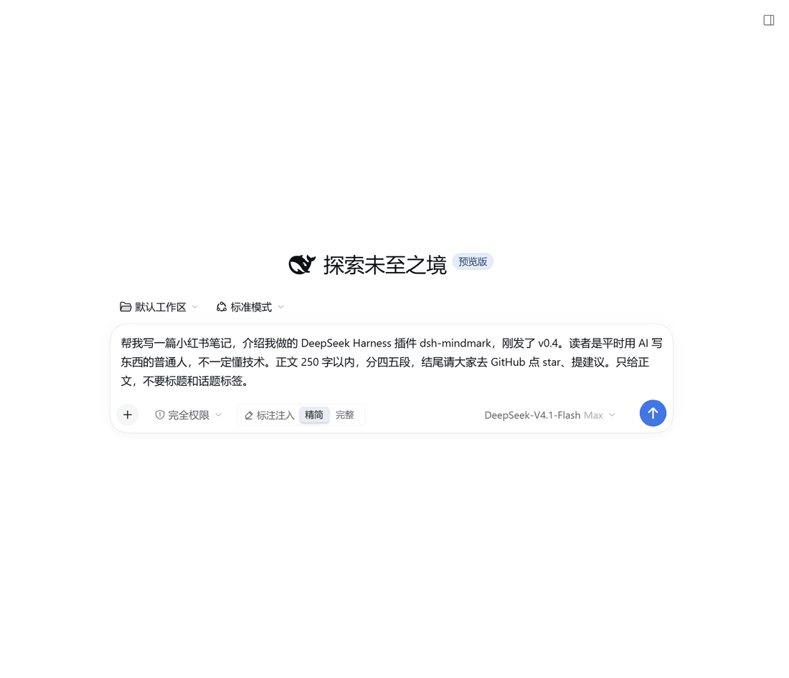

# dsh-mindmark

**Show the model your mind: mark up its answer the way you would in Word.**

English | [中文](README.md)

A [DeepSeek Harness](https://github.com/deepseek-ai/deepseek-harness) plugin. Select any passage of an answer and **highlight, underline, strike, comment on or rewrite** it. On the next turn the model receives your markup as context: not just its own answer, but the answer as you want it understood. It confirms back when it has handled every mark. After a few annotations, one click asks the model to distill them into **long-term preferences** in your global `AGENTS.md`, which every new conversation then follows.



## What it feels like

1. Select text in any answer. The Chat view's own selection bar appears with this plugin's actions:
   **Quote · Highlight · Underline · Strike · Comment · Rewrite · Remove marks**.
2. Highlight, underline and strike apply immediately; comment and rewrite open a small input (confirm with the button or Ctrl+Enter).
3. Send your next message. The model adjusts its answer to your marks, then calls the `annotations` tool to confirm they are handled.
4. The composer gains an **Annotation feed** switch with a pending-count badge:
   - **Brief**: the next turn sends only the annotated passages with a little context;
   - **Full**: the next turn sends the whole answer as a revision view with inline markers.
5. The marker icon in the session header opens the panel: every annotation with its state (pending / handled by the assistant / auto-settled), per-item delete, mark handled, send again, and **Keep as habit**, which asks the model to distill the marks into lasting preferences. Distilled preferences are listed there and can be removed.

## What each mark tells the model

| Mark | Meaning |
|---|---|
| Highlight | This is what I want: keep it and strengthen this direction |
| Underline | Not enough here: expand, clarify or justify |
| Strike | Drop this next time |
| Comment | Act on the note and respond to each one |
| Rewrite | Treat my wording as the correct version |

## How the model sees and answers your marks

- **Pre-step injection.** At the start of every turn the Host renders the conversation's pending annotations into one user-role context message entered right after your prompt, through the official `agent/pre-step` hook. Like every other context plugin it lands in the session log, so you can inspect it in the Trajectory view.
- **Protocol section.** While annotations are pending, a short system-prompt section explains the five marks and the confirmation rule.
- **Confirmation signal.** The model calls the `annotations` tool (`action: resolve`, optional `ids`) when done. Confirmed marks stop being injected and show as "handled by the assistant"; unconfirmed ones come back next turn, up to `maxInjections` (default 3) before they settle automatically.
- **Long-term preferences.** "Keep as habit" prefills a distillation request. The model reviews the marks and calls `annotations` with `action: distill`, which writes one-sentence preferences into a managed block of `$DSH_HOME/AGENTS.md` (`<!-- dsh-mindmark:start -->` … `<!-- dsh-mindmark:end -->`; everything outside the block is preserved). The official workspace-instructions plugin feeds that file to every new session. `lessons` lists, `forget` removes; the panel can remove too.

## Install

```sh
dsh plugin --profile web add dsh-mindmark
```

Or in the Harness plugin page → **Add plugin** → `dsh-mindmark`; for local development use `link:<absolute path>`. A Client-side change needs a Harness restart.

Options in `cordis.patch.yml`:

| Field | Default | Meaning |
|---|---|---|
| `defaultMode` | `brief` | Injection view for new sessions (`brief` / `full`); the composer switch overrides it per session |
| `maxInjections` | `3` | How many turns an unconfirmed mark is re-sent before it settles |

## Layout

```
dsh-mindmark/
├── package.json        # dsh.bundle.patch + dsh.client(platform: web)
├── cordis.patch.yml    # one profile row (defaultMode / maxInjections)
├── index.js            # Host: HTTP route, annotations tool, pre-step injection, protocol section
├── src/store.js        # annotation persistence (state, injection counters, per-session mode, message capture)
├── src/inject.js       # injection text: brief view / full revision view
├── src/lessons.js      # long-term preferences: the managed AGENTS.md block
├── client.js           # Client: selection bar, mode switch, panel, CSS highlight painting
├── locale/{en,zh}.json # plugin-page name and description
└── test/               # node:test suites (store, HTTP, injection, listener, lessons)
```

## Design notes

- **Selection UX reuses the official seam.** The plugin registers into `conversation.chat.text-interaction` (taking over the built-in Quote surface while keeping the Quote action), so the Chat view positions the bar and keeps it attached while scrolling.
- **No dependency on host DOM structure.** Each mark stores the selected text, surrounding context and the scroll container's CSS path, and is re-anchored by scoring every occurrence of the quote; message-level offsets and the full message text are captured from the official `data-text-interaction-source` element for the full revision view.
- **Painting uses the CSS Custom Highlight API** with pending/handled colours per mark; no nodes are inserted into message DOM.
- **HTTP channel:** `/plugins/dsh-mindmark/annotations` (GET and POST: list / add / remove / clear / resolve / reopen / set-mode / forget-lesson).
- Annotations live in `$DSH_HOME/annotations/state.json`, grouped by session, independent of the session log.
- No `@deepseek-ai/*` imports, Node built-ins only, so the bundle loads straight from a linked directory.

## Limits

- Rewrite tells the model what you changed; the model's own history is left untouched by design.
- In full mode overlapping marks fall back to the brief list.
- Marks are painted only for messages currently rendered; virtualised messages re-anchor when scrolled back.
- Multi-agent sessions get no special handling: marks are stored per session.
- Message anchoring relies on the Chat view's `data-chat-node-key` attribute; if upstream renames it, the plugin degrades to text anchoring (affects full mode only).

## License

MIT
