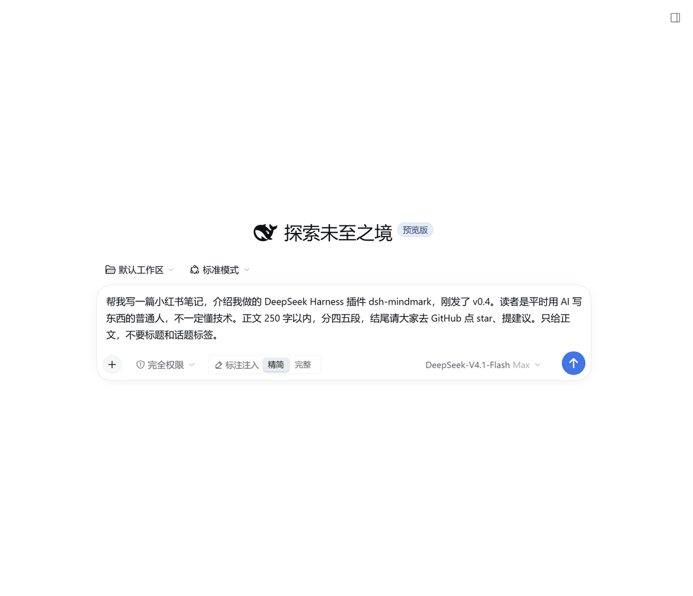

# dsh-mindmark · 思维标注

**把你的想法直接标在回答上，让模型看见你怎么想。**

[English](README.en.md) | 中文

像在 Word 里一样，对助手的回答做**高亮 / 下划线 / 删除 / 批注 / 改写 / 依据 / 移动**。
你的标注会在下一轮作为上下文送给模型：它看到的不再只是自己的回答，而是「你修改后希望它理解的样子」；处理完后它会回传确认。
标注积累几条后，一键让模型把它们归纳成**长期偏好**，写进你的全局 `AGENTS.md`，新对话自动遵守。



演示里让模型写一篇小红书笔记，然后依次：高亮要保留的比喻、给没说清的机制画下划线、删掉一句废话、
批注要求补一句说明、把含糊的仓库提示改写成完整地址、挂上 README 作为依据要求把七种标记列全、
把新功能那句移到前面。下一轮模型逐条照做并确认，最后点「沉淀为习惯」，归纳出 7 条长期偏好。

## 用起来是什么样

1. 在任意一条回答里选中一段文字，Harness 自带的选区浮条会出现，分两排：
   - 第一排点一下就生效：**引用 · 高亮 · 下划线 · 删除 · 清除标记**；
   - 第二排要你补充内容：**批注 · 改写 · 依据 · 移动**。
2. 批注和改写会展开一个小输入框，写完按「确定」（或 Ctrl+Enter）。
3. **依据**：给这一段挂参考材料，让助手只按材料改这一段。材料可以粘贴文本、贴链接或选一个纯文本文件
   （txt / md / csv / json / html 等；PDF、Word 请先复制文字）。可以顺手写一句要求。
4. **移动**像剪切粘贴：选中一段按 **Alt+C**（或点「移动」）拿起，在同一条回答里点一下，
   出现一条闪烁的橙色竖线，这段会插到竖线之后；如果拖选一段文字作为目标，就用被移动的那段替换它。
   按 **Alt+V**（或点底部提示条里的「放到这里」）放下，Esc 取消。提示条里可以写一句为什么要移。
   原处显示橙色虚线。
5. 发下一条消息。模型会先按你的标注调整回答，再调用 `annotations` 工具确认「已处理」。
6. 输入框左侧有「标注注入」开关，可在**精简**和**完整**之间切换，并显示待处理数量：
   - 精简：下一轮只发送被标注的段落和少量上下文；
   - 完整：下一轮发送整条回答的修订视图（标记内嵌在原文里）。
7. 顶栏右上角的标注图标打开面板：看全部标注、状态（待处理 / 助手已处理 / 自动收起）、单条删除、
   标为已处理、重新提交；底部「沉淀为习惯」让模型把标注归纳成长期偏好，面板里能看到并移除已沉淀的偏好。

## 七种标注对助手的含义

| 操作 | 含义 |
|---|---|
| 高亮 | 这是我要的：保留并强化这个方向 |
| 下划线 | 这里不够：展开、澄清或给出依据 |
| 删除 | 去掉：下一版不要再出现 |
| 批注 | 按批注内容处理，并逐条回应 |
| 改写 | 以用户改写后的文字为准 |
| 依据 | 只改这一段：以用户附的材料为准，与材料冲突时听材料的，并说明改动依据了材料的哪一句 |
| 移动 | 把这段挪到用户指定的位置（竖线之后；选了目标文字就替换它），原处不再保留，其余内容不动 |

## 助手怎么「看到」并回应标注

- **步骤前注入**：每一轮开始时，Host 把当前对话里所有待处理的标注渲染成一条用户上下文消息，
  紧跟在你的消息之后进入模型（走官方 `agent/pre-step` 钩子，像其它上下文插件一样落进会话日志，可在「轨迹」里看到）。
- **协议段落**：对话有待处理标注时，系统提示词里多一小段，解释各种标注的含义和确认方式。
- **参考材料**：材料单独存在 `$DSH_HOME/annotations/materials/`，不混进 `state.json`，删标注时一起删。
  2000 字以内的材料随标注整段注入；更长的只注入开头摘录和字数，模型需要时调用
  `annotations` 工具的 `material` 动作分段读取（每次 8000 字，用 `offset` 续读）。
  链接由模型用自己的联网工具打开，打不开时会请你改为粘贴。单份材料最多 20 万字。
- **回传信号**：助手处理完后调用 `annotations` 工具（`action: resolve`，可带 `ids`）确认；
  已确认的标注不再注入，面板里显示「助手已处理」。没确认的会在下一轮再次出现，
  连续 `maxInjections`（默认 3）轮未确认则自动收起，避免无限重发。
- **沉淀为长期偏好**：面板里的「沉淀为习惯」会把一条归纳请求填进输入框；模型回顾标注后调用
  `annotations` 工具的 `distill` 动作，把每条一句的偏好写进 `$DSH_HOME/AGENTS.md` 的一个受管区块
  （`<!-- dsh-mindmark:start -->` … `<!-- dsh-mindmark:end -->`，区块外内容原样保留）。
  官方的工作区指令插件会把这个文件喂给每个新会话。`lessons` 列出、`forget` 移除；面板里也能逐条移除。

## 安装

```sh
dsh plugin --profile web add dsh-mindmark
```

或者在 Harness 的插件页 → **添加插件** → 填 `dsh-mindmark`；本地开发用 `link:<本目录绝对路径>`。
Client 半边改动后需要重启 Harness。

`cordis.patch.yml` 里可配：

| 字段 | 默认 | 说明 |
|---|---|---|
| `defaultMode` | `brief` | 新会话的注入模式（`brief` 精简 / `full` 完整），输入框开关按会话覆盖 |
| `maxInjections` | `3` | 一条未确认的标注最多重发几轮，超过自动收起 |

## 结构

```
dsh-mindmark/
├── package.json        # dsh.bundle.patch + dsh.client(platform: web)
├── cordis.patch.yml    # 往 profile 插件树插入一行（可配 defaultMode / maxInjections）
├── index.js            # Host：HTTP 路由、annotations 工具、pre-step 注入、协议段落
├── src/store.js        # 标注持久化（状态、注入计数、按会话的模式、消息全文捕获、参考材料文件）
├── src/inject.js       # 注入文本：精简视图 / 完整修订视图
├── src/lessons.js      # 长期偏好：AGENTS.md 受管区块的读写
├── client.js           # Client：选区浮条、模式开关、面板、CSS 高亮绘制
├── locale/{en,zh}.json # 插件管理页里的名称与描述
└── test/               # node:test 单测（store + HTTP + 注入 + 监听器 + lessons）
```

## 实现要点

- **选区交互复用官方机制**：注册 `conversation.chat.text-interaction` 槽位（接管内置「引用」的面板并保留引用按钮），
  浮条由 Chat 视图自己定位、随滚动移动，不再自己监听鼠标。需要填写的依据表单放在插件自己的浮层里，
  因为浮条在窗口失去焦点时会关闭，而系统的选文件对话框正会抢走焦点。
- **不依赖宿主 DOM 结构**：标注记录选中原文 + 前后文 + 滚动容器 CSS 路径，恢复时按原文和前后文打分重新定位；
  另外在消息正文（官方的 `data-text-interaction-source` 元素）里记录偏移并捕获全文，供完整模式渲染修订视图。
- **绘制用 CSS Custom Highlight API**，七种样式各有待处理/已处理两种颜色；不往消息 DOM 里插节点。
- **移动的快捷键选 Alt**：Shift 会和输入冲突，Fn 网页读不到，Harness 自己没有占用 Alt+C / Alt+V；
  焦点在输入框里时快捷键不生效，不影响打字。
- **HTTP 通道**：`/plugins/dsh-mindmark/annotations`，GET 与 POST（list / add / remove / clear / resolve / reopen / set-mode / forget-lesson）。
- 标注存在 `$DSH_HOME/annotations/state.json`，按会话分组；与会话日志无关，删会话不会自动删标注。
- 不 import 任何 `@deepseek-ai/*` 包，只用 Node 内置模块，所以能从链接目录直接加载。

## 限制

- 改写只能让助手「知道你改成了什么」，助手看到的历史仍是它原来的回答；这是有意为之，不改会话日志。
- 「依据」要求只改那一段，但模型每次都会重写整条回答，其余段落一字不动只能靠指令约束，无法从技术上保证。
- 移动只支持同一条回答之内；跨消息移动暂不支持。
- 完整模式按消息全文内嵌标记，重叠的标注会退回到精简列出。
- 标注只对当前渲染在页面里的消息绘制；长对话里被虚拟化滚出屏幕的消息，滚回来时重新定位。
- 多智能体场景未做特别处理：标注按会话存储，子会话各自独立。
- 消息锚定依赖 Chat 视图的 `data-chat-node-key` 属性；上游改名时退化为纯文本锚定（只影响完整模式）。

## 更新记录

见 [CHANGELOG.md](CHANGELOG.md)。

## 许可

MIT
